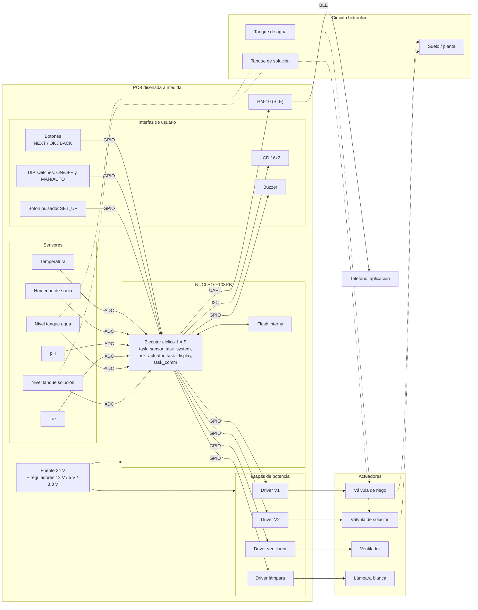

# FIUBA - Electrónica - Taller de Sistemas Embebidos

## Trabajo Final - 2026-2doC - 01A-5: Sistema de Riego Inteligente

### Integrantes del Grupo

| Padrón | Apellidos, Nombres |
| :-: | :-- |
| 112146 | Coluzzi, Santino Leonel |
| 109894 | Kogan, Tobías Daniel |
| 112119 | Rúa, Martino Manuel |

**Entrega:** Propuesta (Semana 11)

**Fecha de entrega estimada del proyecto final:** diciembre de 2026 - febrero de 2027

---

## 1. Selección del proyecto a implementar

### 1.1 Objetivo del proyecto y resultados esperados

El proyecto es un sistema de riego inteligente. Mide la temperatura ambiente, la humedad y el pH del suelo y la iluminación, y con esas lecturas maneja dos válvulas solenoide, un ventilador y una lámpara. Todo el control corre en una placa NUCLEO-F103RB montada sobre una PCB diseñada a medida por el grupo.

El usuario interactúa con el sistema directamente en la placa, mediante un LCD, un buzzer, botones y DIP switches. Además, un módulo HM-10 envía por BLE el estado de funcionamiento y el registro de los sensores a una aplicación del teléfono.

**Componentes del sistema:**

- Una placa **NUCLEO-F103RB** que ejecuta el firmware.
- Un módulo **HM-10 (BLE)** conectado por UART a la NUCLEO, que transmite el estado y el registro de los sensores al teléfono.
- Una **PCB diseñada a medida**, con las etapas de potencia para los acutuadores y sensores, la alimentación y los periféricos de interfaz.
- Dos **tanques de líquido**, uno de agua y otro de solución correctora de pH, cada uno con su válvula solenoide y su sensor de nivel.

**Actuadores:**

- **Válvula solenoide de riego:** riega el suelo cuando la humedad está por debajo del umbral configurado.
- **Válvula solenoide de solución correctora:** corrige el pH cuando este supera el umbral configurado.
- **Ventilador:** se enciende cuando la temperatura supera el umbral configurado.
- **Lámpara blanca:** se enciende cuando la iluminación está por debajo del umbral configurado.

OBS:. La cantidad de líquido que entrega cada válvula se controla por **volumen**.

**Sensores:**

- Un **sensor de Humedad**, uno de **pH**, uno de **temperatura**, uno de **iluminación** y un **sensor de nivel** por tanque.

**Periféricos físicos en la PCB:**

- Un **LCD 16x2** con interfaz I2C, para dar avisos por texto al usuario.
- Un **Buzzer**, para dar avisos sonoros al usuario.
- Tres **Botones**: NEXT, OK y BACK, para navegar los menús.
- Dos **DIP switches:** uno de encendido y apagado del sistema, y otro de modo manual y automático.
- Un **Boton pulsador**, para entrar y salir del modo de SET_UP.

**Resultados esperados:**

1. Un prototipo funcional sobre PCB, con una NUCLEO-F103RB, que opera en los modos AUTOMÁTICO, MANUAL y SET_UP.
2. Ensayos que verifiquen que cada vuelta del ejecutor cíclico dura menos de 1 mS.
3. Aviso al usuario, en la placa y en el teléfono, cuando un tanque queda por debajo del nivel mínimo.
4. Estado de funcionamiento y registro de los sensores visibles en el teléfono en tiempo real.

### 1.2 Proyectos similares

Antes de elegir el enfoque se evaluaron tres alternativas de arquitectura:

1. **Periféricos físicos sin conectividad:** una NUCLEO con LCD, buzzer, DIPs y botones cableados en la PCB. Es lo más simple, pero no usa el módulo HM-10, que es parte del hardware obligatorio de la materia.
2. **Periféricos físicos con HM-10 para monitoreo:** la misma placa con LCD, buzzer, DIPs y botones, más un HM-10 que transmite el estado y el registro de los sensores a una aplicación del teléfono.
3. **Red WiFi:** un nodo (por ejemplo ESP32) por cada sensor o actuador, comunicados por WiFi con un microcontrolador central. Es la opción más flexible, pero la más cara y compleja, y tampoco usa el HM-10.

En la Tabla 1 se comparan las tres alternativas con seis criterios. Cada criterio tiene un peso de 1 a 10, cada alternativa recibe un puntaje de 1 a 10 en cada uno, y el valor ponderado es el producto de ambos. La tabla muestra por qué se eligió la segunda alternativa para este proyecto.

Criterios de comparación (peso entre paréntesis):

- **Disponibilidad de hardware (9):** facilidad para conseguir los componentes en el país.
- **Impacto en el proyecto (8):** cuánto aporta a la funcionalidad del sistema.
- **Viabilidad económica (8):** costo total del hardware.
- **Viabilidad técnica (10):** complejidad y tiempo de desarrollo.
- **Interés del equipo (7):** motivación del grupo.
- **Cumplimiento del enunciado (10):** ajuste a los requisitos obligatorios de la materia.

<table>
  <thead>
    <tr>
      <th rowspan="2">Criterio (peso)</th>
      <th colspan="2">1. Periféricos físicos sin conectividad</th>
      <th colspan="2">2. Periféricos físicos con HM-10 para monitoreo</th>
      <th colspan="2">3. Red WiFi</th>
    </tr>
    <tr>
      <th>Puntaje</th><th>Ponderado</th>
      <th>Puntaje</th><th>Ponderado</th>
      <th>Puntaje</th><th>Ponderado</th>
    </tr>
  </thead>
  <tbody>
    <tr><td>Disponibilidad de hardware (9)</td><td>10</td><td>90</td><td>9</td><td>81</td><td>8</td><td>72</td></tr>
    <tr><td>Impacto en el proyecto (8)</td><td>6</td><td>48</td><td>8</td><td>64</td><td>9</td><td>72</td></tr>
    <tr><td>Viabilidad económica (8)</td><td>10</td><td>80</td><td>9</td><td>72</td><td>5</td><td>40</td></tr>
    <tr><td>Viabilidad técnica (10)</td><td>10</td><td>100</td><td>8</td><td>80</td><td>4</td><td>40</td></tr>
    <tr><td>Interés del equipo (7)</td><td>5</td><td>35</td><td>8</td><td>56</td><td>8</td><td>56</td></tr>
    <tr><td>Cumplimiento del enunciado (10)</td><td>5</td><td>50</td><td>10</td><td>100</td><td>6</td><td>60</td></tr>
    <tr><td><b>Puntaje total</b></td><td></td><td><b>403</b></td><td></td><td><b>453</b></td><td></td><td><b>340</b></td></tr>
  </tbody>
</table>

*Tabla 1: Comparación de alternativas (puntajes asignados por el grupo).*

### 1.3 Selección de proyecto

Se elige la alternativa 2, periféricos físicos con HM-10 para monitoreo. Es la que mejor cumple el enunciado, porque usa el HM-10, el LCD, el buzzer, los DIPs y los botones, y mantiene una sola placa y una complejidad técnica razonable.

El HM-10 funciona como un puente UART transparente. El firmware envía por UART líneas de texto con el modo vigente, las lecturas de los sensores y los avisos, y el HM-10 las transmite por BLE. La aplicación del teléfono muestra ese texto tal como llega. Como la aplicación no envía nada, el sistema funciona igual con el teléfono desconectado. En interiores y con pocos obstáculos se estima un alcance de unos 10 m, que se va a medir en los ensayos.

Los principales desafíos son:

- Medir el nivel de cada tanque con suficiente estabilidad como para calcular volúmenes por diferencia de altura.
- Cumplir el presupuesto de 1 mS por vuelta del ejecutor cíclico con tareas no bloqueantes.
- Garantizar un estado seguro ante un tanque escaso y ante el apagado del sistema desde el DIP switch.
- Guardar la configuración en el Flash sin romper el presupuesto de tiempo.
- Diseñar y fabricar la PCB con las etapas de potencia para las válvulas, el ventilador y la lámpara.

En la Figura 1 se observa la arquitectura completa. En el centro está el microcontrolador NUCLEO-F103RB, que recibe por ADC las lecturas de los seis sensores (los cuatro de variables ambientales y de suelo, y los dos de nivel de tanque) y por GPIO el estado de los DIPs, del pulsador SET_UP y de los botones. El LCD cuelga del bus I2C y el buzzer de un GPIO. Cada actuador se maneja con su propia etapa de potencia. La conexión con el teléfono se hace a través del módulo HM-10 por BLE y del HM-10 hacia el microcontrolador por UART, y va en un solo sentido: de la placa hacia la aplicación. El diagrama sirve para ver qué señales entran, qué señales salen y como están separados los diferentes módulos de este sistema.

*Figura 1: Diagrama en bloques del sistema. Las líneas continuas son señales eléctricas y las punteadas el circuito hidráulico.*

#### 1.3.1 Modos de operación y prioridades

El sistema tiene cinco modos: APAGADO, SET_UP, FALLA, MANUAL y AUTOMÁTICO. Como pueden darse varias de estas condiciones a la vez, en cada vuelta del ejecutor se decide el modo actual utilizando un orden de prioridad. En la Tabla 2 se muestra ese orden, y la incluimos porque define qué pasa cuando, por ejemplo, el usuario está configurando y se vacía un tanque.

| Prioridad | Condición | Modo resultante |
| :-: | :-- | :-- |
| 1 | DIP de encendido en OFF | APAGADO |
| 2 | Pulsador SET_UP enclavado | SET_UP |
| 3 | Algún tanque por debajo del nivel mínimo | FALLA |
| 4 | DIP MAN/AUTO en nivel bajo | MANUAL |
| 4 | DIP MAN/AUTO en nivel alto | AUTOMÁTICO |

*Tabla 2: Prioridad de los modos de operación.*

Los dos estados de las filas de prioridad 4 son mutuamente excluyentes porque salen del mismo DIP switch: en nivel alto el sistema está en automático y en nivel bajo, en manual. Algunos detalles de cada modo:

- **APAGADO:** deja los actuadores y sensores en estado stand-by, pero no corta la alimentación. Para cortarla hay que desconectar la fuente.
- **SET_UP:** el sistema se mantiene en este modo hasta que el usuario vuelve a presionar el pulsador y este se levanta. Los actuadores y sensores quedan en stand-by mientras tanto.
- **FALLA:** se llega cuando al menos un tanque queda por debajo su nivel mínimo establecido. Se bloquean todos los actuadores y se avisa al usuario con el buzzer, el LCD y la aplicación. Este modo se sale solo cuando el sensor detecta que el tanque se rellenó y está por encima del nivel mínimo.
- **MANUAL:** el usuario acciona el ventilador, la lámpara y las válvulas manualmente desde el LCD con los botones NEXT, OK y BACK.
- **AUTOMÁTICO:** el firmware decide según los umbrales configurados en SET_UP.

Los botones NEXT, OK y BACK solo actúan en modo MANUAL y SET_UP, y se ignoran en los demás modos.

Si un tanque baja del nivel mínimo en medio de una entrega, la válvula no se cierra: termina de entregar el volumen pedido. Recién después se pasa a FALLA y se avisa al usuario que tiene que rellenar el tanque.

### 1.4 Hardware

La Tabla 3 lista el hardware utilizado en el proyecto.

| Elemento | Detalle |
| :-- | :-- |
| Placa | NUCLEO-F103RB, única placa del sistema. |
| Módulo HM-10 | Módulo BLE conectado por UART a la NUCLEO. Solo transmite el estado y el registro de los sensores a la aplicación del teléfono. |
| DIP switches | Dos DIP switches en la PCB: encendido/apagado y manual/automático. |
| Boton pulsador y otros botones | Un boton pulsador SET_UP y otros tres botones NEXT, OK y BACK. |
| Buzzer | Avisa al usuario cuando hay que rellenar un tanque. |
| Sensores analógicos | Humedad de suelo, pH, luz, temperatura y nivel, leídos por ADC. |
| Almacenamiento | Flash interna de la NUCLEO para guardar la configuración del SET_UP. |
| Interconexión | PCB diseñada y fabricada para el proyecto. |
| LCD 16x2 | Con expansor PCF8574, conectado por I2C. Muestra el modo, las lecturas, los menús y los avisos. |
| Válvulas solenoide | Dos válvulas de 12 V: una para riego y otra para la solución correctora. |
| Ventilador | Ventilador tipo PC de 12 V. |
| Lámpara blanca | Lámpara LED blanca de baja potencia. |
| Alimentación | Fuente de 24 V y reguladores a 12 V, 5 V y 3,3 V. |
| Tanques | Dos tanques de sección constante, uno de agua y otro de solución correctora, con su cañería. |

*Tabla 3: Componentes de hardware del sistema.*

### 1.5 Programación

La Tabla 4 resume los requisitos de programación del proyecto y su implementación.

| Requisito | Aplicación en el proyecto |
| :-- | :-- |
| Bare Metal, Event-Triggered System | Sin sistema operativo. Las tareas reaccionan a los eventos de los botones, los DIPs y el pulsador, a las lecturas de los sensores y a los tiempos. |
| Estructurada y modular | Un módulo por función: `task_sensor`, `task_system`, `task_actuator`, `task_display` y `task_comm`. |
| Ejecutor cíclico, 1 vuelta < 1 mS | `app_update()` recorre las tareas en cada tick. Se mide NOE, LET, BCET y WCET de cada tarea. |
| Tick de 1 mS | `HAL_SYSTICK_Callback()` incrementa un contador de ticks pendientes. |
| Tareas no bloqueantes | Cada tarea hace una porción de trabajo por tick, sin `delay()` bloqueantes. |
| Modelos, diagramas de estado e interfaces | Máquinas de estado de los modos y de los menús, modeladas en Itemis Create y codificadas en C. Interfaces con colas, estructuras y arrays de estructuras. |
| Menú interactivo | Menús MANUAL y SET_UP en el LCD, navegables con NEXT, OK y BACK. |
| Al menos dos modos de operación | APAGADO, AUTOMÁTICO, MANUAL, SET_UP y FALLA. |
| Periférico I2C | LCD 16x2 con PCF8574. |
| Polling, interrupciones o DMA | ADC por DMA o por polling. UART del HM-10 por interrupción o DMA. DIP switches, boton pulsador y otros botones por polling con antirrebote. |
| Cálculo de volumen | Volumen entregado = sección del tanque por la diferencia de altura medida + offset. |
| Configuración en Flash con CRC | Guarda los umbrales, los niveles mínimos y los volúmenes de dosis, y valida el contenido al arrancar. La escritura bloquea la CPU y rompe el límite de 1 mS, por lo que solo se hace al salir de SET_UP y únicamente si el usuario confirmó algún cambio. Se documenta como excepción del WCET. |
| Resolución de modos por prioridad | Aplica la Tabla 2 en cada vuelta, con salida automática de FALLA. |
| Dosificación con control de volumen | Abre la válvula hasta entregar el volumen pedido y la cierra. |
| Transmisión de estado y registro | Envía por UART al HM-10 líneas de texto con el modo, las lecturas y los avisos. |
| Registro (*logger*) | Salida por UART o semihosting para depuración y mediciones. |

*Tabla 4: Requisitos de programación y funcionalidades adicionales implementadas.*

---

## 2. Elicitación de requisitos y casos de uso

### 2.1 Soluciones existentes

Para ubicar el proyecto frente a lo que ya existe, revisamos tres soluciones comerciales de riego con control inalámbrico. En la Tabla 5 se resume qué hace cada una, cómo se conecta y en qué se diferencia de nuestro sistema. No incluimos precios porque cambian seguido y varían según el país.

| Producto | Qué hace | Conexión | Diferencia con nuestro proyecto |
| :-- | :-- | :-- | :-- |
| **GARDENA Water Control Bluetooth** | Se conecta a canillas con rosca de 26,5 mm (G 3/4) o 33,3 mm (G 1) y se configura desde la app GARDENA Bluetooth, dentro de un radio de unos 10 m. Permite programar hasta 3 riegos automáticos con distintos horarios, duraciones y repeticiones, y se puede configurar una pausa por lluvia. Admite el sensor de humedad de suelo de GARDENA. Funciona con una pila alcalina de 9 V que no se incluye. | Bluetooth; el teléfono debe soportar Bluetooth Low Energy 4.0. | Riega por programa horario y, con el sensor opcional, puede tener en cuenta la humedad del suelo. |
| **Eve Aqua** | Controlador que se conecta a una canilla exterior y riega según los horarios que se cargan en la app Eve, con hasta 7 períodos de riego por día. Tiene un botón para abrir o cerrar el agua sin la app y, al terminar cada riego, muestra cuánta agua se usó, calculada con un caudal que el usuario puede ajustar. No depende de la nube ni de un puente para regar. Funciona con 2 pilas AA. | Bluetooth y Thread. Funciona solo con dispositivos Apple, y para controlarlo fuera de casa hace falta un HomePod, un HomePod mini o un Apple TV. | Riega por horario, puede frenar el riego en días de lluvia y reporta el consumo. |
| **RainPoint, temporizador Bluetooth para manguera** | Se conecta a la canilla y se programa desde la app RainPoint, con dos tipos de programa (riego a una hora fija o riego repetido en ciclos con pausas para que el suelo absorba), riego manual temporal sin cambiar el programa y un retraso por lluvia de 24, 48 o 72 horas. Una vez cargado el programa, riega aunque el teléfono se desconecte. | Bluetooth, con un alcance publicado de 60 m. | Riega por programa horario o en ciclos, con retraso por lluvia que el usuario elige. |

*Tabla 5: Soluciones existentes relevadas.*

Fuentes:

- GARDENA: <https://www.gardena.com/int/products/watering/water-controls/water-control-bluetooth/970481101.html>.
- Eve Aqua: <https://www.legitreviews.com/eve-aqua-smart-water-controller-review_228384> y <https://www.trustedreviews.com/reviews/eve-aqua>.
- RainPoint: <https://www.amazon.com/RAINPOINT-Sprinkler-Outdoor-Bluetooth-Irrigation/dp/B0BS1DNK4H>.

Los tres son productos cerrados que resuelven una parte del problema: riego por horario, que en algunos casos se puede ajustar con un sensor de humedad de suelo. Ninguno integra la corrección de pH con una solución, el control de temperatura con ventilación, la iluminación con lámpara ni el aviso por nivel de tanque. Esa diferencia es lo que buscamos cubrir al juntar todas esas funciones en un solo sistema con un firmware diseñado para esto.

### 2.2 Requisitos del proyecto

La Tabla 6 reúne los requisitos del sistema, agrupados por tema y con un identificador para poder referirnos a cada uno en las entregas siguientes. Es la base contra la que vamos a verificar el prototipo al final del trabajo.

| Grupo | ID | Requisito |
| :-- | :-: | :-- |
| Sensores | 1.1 | El sistema medirá la temperatura ambiente. |
| | 1.2 | El sistema medirá la humedad del suelo con un sensor analógico. |
| | 1.3 | El sistema medirá el pH del suelo con un sensor analógico. |
| | 1.4 | El sistema medirá la iluminación ambiente. |
| | 1.5 | El sistema medirá de forma continua el nivel de cada tanque (agua y solución correctora) con un sensor analógico por tanque. |
| Actuadores | 2.1 | Una válvula solenoide regará cuando la humedad esté por debajo del mínimo configurado. |
| | 2.2 | Una segunda válvula solenoide entregará solución correctora cuando el pH supere el umbral configurado. |
| | 2.3 | Cada válvula entregará el volumen pedido, calculado como la sección del tanque por la diferencia de altura medida, y se cerrará al alcanzarlo. |
| | 2.4 | Un ventilador se activará cuando la temperatura supere el umbral configurado. |
| | 2.5 | Una lámpara blanca se activará cuando la luz esté por debajo del umbral configurado. |
| Modos y seguridad | 3.1 | El DIP switch de encendido en OFF llevará el sistema a APAGADO. |
| | 3.2 | Un segundo DIP switch elegirá el modo: nivel alto para AUTOMÁTICO y nivel bajo para MANUAL. |
| | 3.3 | Un boton pulsador llevará el sistema a SET_UP y lo mantendrá ahí hasta que se lo vuelva a presionar. En SET_UP los actuadores quedarán apagados. |
| | 3.4 | El modo de funcionamiento se determinará siguiendo el orden de prioridad establecido en la Tabla 2. |
| | 3.5 | Si un tanque queda por debajo del nivel mínimo, el sistema terminará la entrega en curso, pasará a FALLA, bloqueará los actuadores y solo saldrá de este modo, al rellenarse por encima del nivel mínimo establecido. |
| Interfaz en la placa | 4.1 | Un LCD 16x2 con PCF8574 por I2C mostrará el modo, las lecturas y los avisos. |
| | 4.2 | Los botones NEXT, OK y BACK actuarán solo en MANUAL y SET_UP. |
| | 4.3 | En MANUAL se recorrerán válvula de agua, válvula de solución, ventilador y lámpara. El ventilador y la lámpara tendrán submenú ON/OFF y las válvulas, submenú de volumen. |
| | 4.4 | En MANUAL no se podrá pedir un volumen mayor al que hay en el tanque. |
| | 4.5 | En SET_UP se editarán humedad mínima, temperatura máxima, luz mínima, pH máximo, nivel mínimo de cada tanque y volumen de dosis de cada válvula. OK confirmará cada valor y BACK lo descartará. |
| | 4.6 | En SET_UP el volumen de dosis de cada válvula no podrá superar el volumen correspondiente al nivel mínimo de su tanque. Si se intenta, el LCD lo rechazará. |
| | 4.7 | El buzzer avisará cuando un tanque quede por debajo del nivel mínimo. |
| Almacenamiento | 5.1 | Los umbrales, los niveles mínimos y los volúmenes de dosis confirmados se guardarán en la Flash interna con CRC. |
| | 5.2 | Se escribirá en Flash solo al salir de SET_UP y únicamente si el usuario confirmó algún valor. |
| Monitoreo | 6.1 | El firmware enviará por UART al HM-10, en forma periódica, líneas de texto con el modo, las lecturas de los sensores y los avisos. |
| | 6.2 | La aplicación del teléfono recibirá y mostrará ese texto. El sistema debe funcionar igual con el teléfono desconectado. |
| Tiempo real | 7.1 | Cada vuelta del ejecutor cíclico durará menos de 1 mS, salvo cuando se realiza la escritura de Flash, cuyo tiempo se medirá y documentará como excepción. |

*Tabla 6: Requisitos del proyecto.*

Quedan fuera de alcance el control del sistema desde la aplicación, la conectividad WiFi y el corte de la alimentación en APAGADO.

### 2.3 Casos de uso

Los casos de uso describen cómo se comporta el sistema en las situaciones principales, desde lo que dispara cada una hasta qué pasa si algo sale distinto de lo esperado. Cada caso tiene su tabla, numerada de la Tabla 7 a la 13, y juntos cubren los 5 modos de operación.

El primero es el riego automático. En la Tabla 7 se ve que el sistema riega cuando la humedad baja del umbral y que siempre entrega un volumen medido.

| Elemento | Definición |
| :-- | :-- |
| **Disparador** | La humedad del suelo cae por debajo del mínimo configurado. |
| **Precondiciones** | Modo AUTOMÁTICO. Tanque de agua por encima del nivel mínimo. Umbrales cargados desde Flash. |
| **Flujo principal** | El firmware lee la humedad, detecta que está bajo el mínimo y abre la válvula de riego. Mide la altura del tanque hasta que la diferencia equivale al volumen configurado y entonces cierra la válvula. Vuelve a medir y repite el ciclo si la humedad sigue baja. |
| **Flujos alternativos** | a. Si al terminar la entrega el tanque queda por debajo del nivel mínimo, se pasa a FALLA y se avisa al usuario que tiene que rellenarlo. b. Si la válvula se abre y la altura no cambia, se cierra y se pasa a FALLA. c. DIP de encendido en OFF: se cierra la válvula y se pasa a APAGADO. d. Boton pulsador SET_UP apretado: se cierra la válvula y se pasa a SET_UP. |

*Tabla 7: Caso de uso 1: Riego automático.*

El segundo caso es la corrección de pH. La Tabla 8 muestra que funciona igual que el riego, pero con la válvula de solución, y que incluye una espera para que la solución se mezcle antes de volver a medir.

| Elemento | Definición |
| :-- | :-- |
| **Disparador** | El pH medido supera el umbral configurado. |
| **Precondiciones** | Modo AUTOMÁTICO. Tanque de solución por encima del nivel mínimo. Umbrales cargados desde Flash. |
| **Flujo principal** | El firmware abre la válvula de solución correctora y la cierra al entregar el volumen configurado. Espera el tiempo de mezcla y vuelve a medir. Repite hasta volver al rango o llegar al límite máximo de dosis. |
| **Flujos alternativos** | a. Si al terminar la entrega el tanque de solución queda por debajo del nivel mínimo, se pasa a FALLA y se avisa al usuario. b. Si se alcanza el límite de dosis sin corregir, se muestra una alarma en el LCD y suena el buzzer. c. Si la lectura de pH está fuera del rango físico del sensor, se informa falla de sensor y no se dosifica. |

*Tabla 8: Caso de uso 2: Corrección de pH.*

El tercero es el control de temperatura e iluminación. La Tabla 9 resume cuándo se encienden el ventilador y la lámpara, y cómo se apagan.

| Elemento | Definición |
| :-- | :-- |
| **Disparador** | La temperatura supera el máximo configurado (ventilador) o la luz cae por debajo del mínimo configurado (lámpara). |
| **Precondiciones** | Modo AUTOMÁTICO. Sensor correspondiente operativo. Umbrales cargados desde Flash. |
| **Flujo principal** | El firmware enciende el ventilador (o la lámpara blanca). Cuando la variable vuelve al rango de funcionamiento, lo apaga. |
| **Flujos alternativos** | a. Si se pasa a FALLA, APAGADO o SET_UP, el ventilador y la lámpara quedan apagados. |

*Tabla 9: Caso de uso 3: Control de temperatura e iluminación.*

El cuarto caso es el del tanque escaso, que lleva al sistema a FALLA. La Tabla 10 muestra que una entrega en curso se completa antes de bloquear los actuadores.

| Elemento | Definición |
| :-- | :-- |
| **Disparador** | El nivel de algún tanque queda por debajo del nivel mínimo configurado. |
| **Precondiciones** | DIP switch de encendido en ON y SET_UP desactivado. |
| **Flujo principal** | Si hay una entrega en curso, la válvula termina de entregar el volumen pedido. Luego el firmware cierra ambas válvulas, apaga el ventilador y la lámpara y pasa a FALLA. Avisa con el buzzer y el LCD, y envía el aviso a la aplicación. Cuando el usuario rellena el tanque y el nivel supera el nivel mínimo, el sistema sale de FALLA y vuelve al modo que corresponde según la Tabla 2. |
| **Flujos alternativos** | a. Si el teléfono no está conectado, el sistema igual bloquea los actuadores y avisa en la placa. b. Si el usuario baja el DIP switch de encendido o presiona el boton de SET_UP, se pasa a APAGADO o SET_UP según corresponda. |

*Tabla 10: Caso de uso 4: Tanque escaso (modo FALLA).*

El quinto caso es la operación manual. En la Tabla 11 se ve cómo el usuario recorre los actuadores con los botones y qué límite se aplica al volumen que puede pedir.

| Elemento | Definición |
| :-- | :-- |
| **Disparador** | El usuario pone el DIP switch MAN/AUTO en nivel bajo. |
| **Precondiciones** | DIP switch de encendido en ON, SET_UP desactivado y ningún tanque por debajo del nivel mínimo. |
| **Flujo principal** | El firmware suspende las decisiones automáticas. Con NEXT recorre válvula de agua, válvula de solución, ventilador y lámpara. Con OK entra al submenú: ON/OFF para el ventilador y la lámpara, y volumen para las válvulas. BACK sube un nivel en el menú, OK confirma una acción. El LCD muestra el actuador y su estado. |
| **Flujos alternativos** | a. Si el usuario pide un volumen mayor al que hay en el tanque, el LCD lo rechaza. b. Si el usuario vuelve el DIP switch MAN/AUTO a nivel alto, se retoma el control automático. c. Si un tanque queda por debajo del nivel mínimo, se pasa a modo FALLA. |

*Tabla 11: Caso de uso 5: Operación manual.*

El sexto caso es la configuración. La Tabla 12 describe cómo se entra y se sale de SET_UP y qué pasa con los valores que el usuario cambia, que solo se guardan si los confirmó.

| Elemento | Definición |
| :-- | :-- |
| **Disparador** | El usuario presiona el pulsador SET_UP, que queda enclavado. |
| **Precondiciones** | DIP switch de encendido en ON. |
| **Flujo principal** | Los actuadores quedan apagados. Con NEXT el usuario elige un parámetro (humedad mínima, temperatura máxima, luz mínima, pH mínimo y máximo, nivel mínimo de cada tanque o volumen de dosis) y lo modifica. OK confirma el valor y BACK lo descarta. Cuando el usuario vuelve a presionar el pulsador y este se levanta, el sistema sale de SET_UP. Si hubo valores confirmados, el firmware los escribe en el Flash con CRC. |
| **Flujos alternativos** | a. Si el usuario entra y sale sin confirmar nada, no se escribe en el Flash. b. Si el volumen de dosis supera el del nivel mínimo del tanque, el LCD lo rechaza. c. Si la alimentación se corta antes de salir de SET_UP, se pierden los cambios confirmados en esa sesión. |

*Tabla 12: Caso de uso 6: Configuración (SET_UP).*

El último caso es el monitoreo desde el teléfono. La Tabla 13 muestra que la aplicación solo observa.

| Elemento | Definición |
| :-- | :-- |
| **Disparador** | El usuario abre la aplicación y se conecta al HM-10. |
| **Precondiciones** | Sistema encendido. |
| **Flujo principal** | El firmware envía periódicamente por UART líneas de texto con el modo, las lecturas de los sensores y los avisos. El HM-10 las transmite por BLE y la aplicación las muestra en tiempo real. |
| **Flujos alternativos** | a. Si el teléfono se desconecta o se cierra la aplicación, el sistema sigue funcionando. |

*Tabla 13: Caso de uso 7: Monitoreo desde la aplicación.*

### 2.4 Limitaciones y supuestos

- **Exactitud de la dosis:** el volumen entregado se calcula con la variación de altura del tanque, así que la exactitud depende de la resolución del sensor de nivel. Con dosis chicas la variación de altura es chica y el error relativo aumenta.
- **Corte de alimentación en SET_UP:** los valores confirmados en una sesión se escriben en el Flash al salir de SET_UP. Si se corta la alimentación antes, se pierden y el sistema arranca con los valores guardados anteriormente.
- **APAGADO:** deja los actuadores en estado seguro pero no corta la alimentación. Para cortarla hay que desconectar la fuente.
- **Aplicación del teléfono:** solo recibe y muestra texto. No se puede controlar el sistema desde ella, y el aviso por buzzer suena únicamente en la placa.
- **Supuesto:** el formato de las líneas de texto que se envían al HM-10 lo define el grupo, y la aplicación las muestra tal como llegan.
- **Supuesto:** los modelos de sensores, las constantes de calibración de los tanques (sección y altura) y los valores por defecto de los umbrales se definen en la etapa de diseño.
