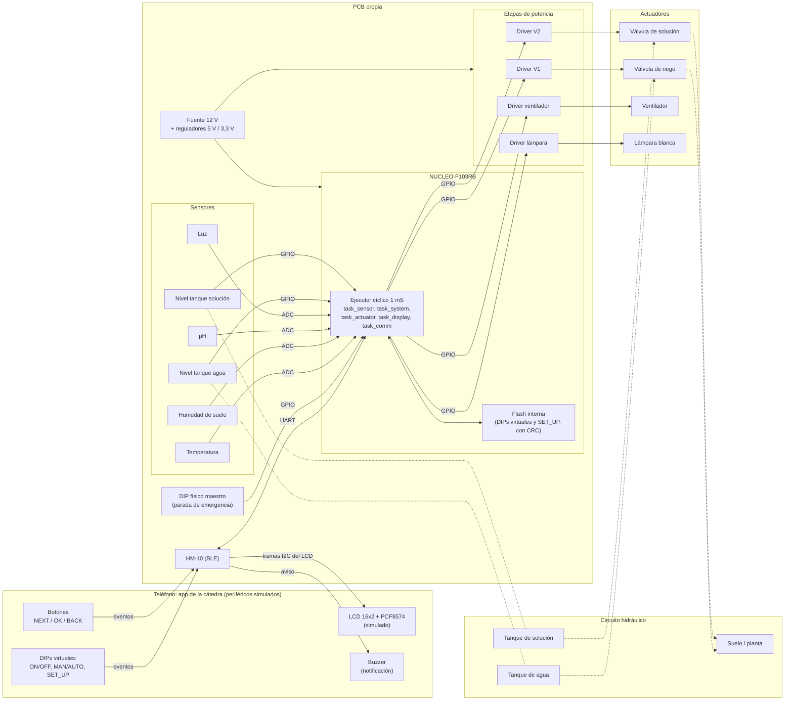

# FIUBA - Electrónica - Taller de Sistemas Embebidos
## Trabajo Final - 2026-2doC - 01A-5: Sistema de Riego Inteligente

### Integrantes del Grupo

| Padrón | Apellidos, Nombres |
| :-: | :-- |
| 112146 | Coluzzi, Santino Leonel |
| 109894 | Kogan, Tobías Daniel |
| 112119 | Rúa, Martino Manuel |

**Entrega:** Propuesta (Semana 11)
**Fecha de entrega estimada del proyecto final:** diciembre de 2026 - febrero de 2027

---

## 1. Selección del proyecto a implementar

### 1.1 Objetivo del proyecto y resultados esperados

Desarrollar un sistema de riego inteligente que mide variables ambientales y del suelo (temperatura, humedad, pH e iluminación) y actúa en consecuencia sobre dos válvulas solenoide, un ventilador y una lámpara. El sistema se controla con **una única placa NUCLEO-F103RB** montada sobre una **PCB propia**. La interfaz de usuario (display, buzzer, DIPs y botones) se resuelve con la **aplicación de la cátedra por BLE**, que se comporta como un conjunto de periféricos simulados y no tiene lógica propia: toda la lógica de control está en el firmware.

**Sistema:**
- Una placa **NUCLEO-F103RB** que ejecuta todo el firmware.
- Un módulo **HM-10 (BLE)** conectado por UART a la NUCLEO, que comunica el sistema con el teléfono.
- Una **PCB** propia con las etapas de potencia, el acondicionamiento de sensores y la alimentación.
- Dos **tanques de líquido**: uno de agua y otro de solución correctora de pH, cada uno con su válvula solenoide.

**Actuadores:**
- **Válvula solenoide de riego**: irriga el suelo cuando la humedad es baja.
- **Válvula solenoide de solución correctora**: corrige el pH cuando está fuera del rango configurado.
- **Ventilador**: se activa cuando la temperatura supera el máximo configurado.
- **Lámpara blanca**: se activa cuando la iluminación está por debajo del mínimo configurado.

La cantidad de líquido que entrega cada válvula se controla por **tiempo de apertura en segundos**.

**Sensores:**
- **Humedad** del suelo, **pH** del suelo, **temperatura** ambiente e **iluminación** ambiente.
- Dos **sensores de nivel**, uno por tanque.

**Periféricos simulados por la app de la cátedra (por BLE):**
- **LCD 16x2** con interfaz I2C (expansor PCF8574) simulada. El firmware arma las tramas como si el LCD fuera físico y viajan por UART, HM-10 y BLE.
- **Buzzer**, que se materializa como una notificación en el teléfono.
- **DIPs virtuales**: encendido/apagado (pausa remota), manual/automático y SET_UP.
- **Botones NEXT, OK y BACK**.

**Periférico físico:**
- **DIP maestro** en la NUCLEO: parada de emergencia.

Resultados esperados:
1. Un prototipo funcional sobre PCB con una NUCLEO-F103RB y un HM-10, controlable desde la app de la cátedra.
2. Operación automática, manual y de configuración (SET_UP) con modo FALLA por tanque escaso.
3. Ensayos que verifiquen que cada vuelta del ejecutor cíclico dura menos de 1 mS, con la escritura de Flash documentada como excepción medida.
4. Comportamiento seguro ante falta de líquido y continuidad de la operación automática si se pierde el enlace con la app.

### 1.2 Proyectos similares

Se evaluaron tres alternativas de arquitectura:

1. **Periféricos físicos:** una NUCLEO con LCD, buzzer, DIPs y botones físicos cableados en la PCB. Es lo más simple, pero no utiliza el módulo HM-10 ni la app de la cátedra, por lo que no cumple con la conexión inalámbrica que se pretende.
2. **Una placa con app por BLE (HM-10):** una NUCLEO con el HM-10 conectado a la app de la cátedra, que simula los periféricos de interfaz. Los sensores y actuadores están en la PCB. El enlace es un único punto a punto con el teléfono.
3. **Red WiFi:** un nodo (por ejemplo ESP32) por sensor o actuador, comunicados por WiFi con un microcontrolador central. Es la opción más flexible, pero la más cara y compleja, y no usa el HM-10.

Criterios de comparación (peso entre paréntesis, de 1 a 10):

- **Disponibilidad de hardware (9):** facilidad para conseguir los componentes localmente.
- **Impacto en el proyecto (8):** cuánto aporta a la funcionalidad.
- **Viabilidad económica (8):** costo total del hardware.
- **Viabilidad técnica (10):** complejidad y tiempo requerido.
- **Interés del equipo (7):** motivación del grupo.
- **Cumplimiento del enunciado (10):** ajuste a los requisitos obligatorios de la materia.

<table>
  <thead>
    <tr>
      <th rowspan="2">Criterio (peso)</th>
      <th colspan="2">Periféricos físicos</th>
      <th colspan="2">Una placa con app por BLE (HM-10)</th>
      <th colspan="2">Red WiFi</th>
    </tr>
    <tr>
      <th>Puntaje</th><th>Ponderado</th>
      <th>Puntaje</th><th>Ponderado</th>
      <th>Puntaje</th><th>Ponderado</th>
    </tr>
  </thead>
  <tbody>
    <tr><td>Disponibilidad de hardware (9)</td><td>10</td><td>90</td><td>9</td><td>81</td><td>8</td><td>72</td></tr>
    <tr><td>Impacto en el proyecto (8)</td><td>6</td><td>48</td><td>8</td><td>64</td><td>9</td><td>72</td></tr>
    <tr><td>Viabilidad económica (8)</td><td>10</td><td>80</td><td>9</td><td>72</td><td>5</td><td>40</td></tr>
    <tr><td>Viabilidad técnica (10)</td><td>10</td><td>100</td><td>8</td><td>80</td><td>4</td><td>40</td></tr>
    <tr><td>Interés del equipo (7)</td><td>5</td><td>35</td><td>8</td><td>56</td><td>8</td><td>56</td></tr>
    <tr><td>Cumplimiento del enunciado (10)</td><td>5</td><td>50</td><td>10</td><td>100</td><td>6</td><td>60</td></tr>
    <tr><td><b>Puntaje total</b></td><td></td><td><b>403</b></td><td></td><td><b>453</b></td><td></td><td><b>340</b></td></tr>
  </tbody>
</table>

*Tabla 1: Comparación de alternativas (puntajes asignados por el grupo).*

### 1.3 Selección de proyecto

Se selecciona la alternativa **Una placa con app por BLE (HM-10)**. Es la que mejor cumple el enunciado: usa el HM-10, mantiene un costo bajo (una sola placa) y una complejidad técnica razonable, y permite tener un display, un buzzer, DIPs y botones sin fabricar ese hardware.

El HM-10 funciona como un puente UART transparente. El firmware se diseña **como si los periféricos fueran físicos**: arma las tramas I2C del LCD con PCF8574 y las envía por UART; la app las interpreta y las dibuja. En sentido inverso, los DIPs virtuales y los botones NEXT, OK y BACK llegan al firmware como eventos por la misma UART. En interiores y con pocos obstáculos se estima un alcance de unos 10 m. El alcance real se medirá en los ensayos.

**Principio de operación:** el firmware es quien manda. Ejecuta el estado que está guardado en la Flash interna y se lo informa a la app cada vez que ésta se conecta. **Si la app se cierra o se pierde el enlace, el sistema sigue funcionando solo** con la última configuración guardada.

Principales desafíos:
- Armar y decodificar las tramas que intercambia la app de la cátedra, sin bloquear el ejecutor cíclico.
- Cumplir el presupuesto de 1 mS por vuelta del ejecutor cíclico con tareas no bloqueantes.
- Garantizar un estado seguro ante tanque escaso y ante parada de emergencia.
- Guardar la configuración en Flash sin romper el presupuesto de tiempo, documentando la excepción.
- Diseñar y fabricar la PCB con etapas de potencia para las válvulas, el ventilador y la lámpara.

#### 1.3.1 Diagrama en bloques

*Figura 1: Diagrama en bloques del sistema. Las líneas continuas son señales eléctricas y las punteadas son el circuito hidráulico. Las tramas entre la NUCLEO y la app viajan por UART, HM-10 y BLE.*

#### 1.3.2 Modos de operación y prioridades

El modo vigente se decide en cada vuelta del ejecutor aplicando la siguiente prioridad (gana la primera condición que se cumple):

| Prioridad | Condición | Modo resultante |
| :-: | :-- | :-- |
| 1 | DIP físico maestro en OFF | APAGADO (parada de emergencia) |
| 2 | DIP virtual de encendido en OFF | APAGADO (pausa remota) |
| 3 | Algún tanque con nivel escaso | FALLA |
| 4 | DIP virtual SET_UP activo | SET_UP, con actuadores en estado seguro |
| 5 | DIP virtual en MANUAL | MANUAL |
| 6 | Resto de los casos | AUTOMÁTICO |

*Tabla 1.1: Prioridad de modos de operación.*

- El **DIP físico maestro** no se guarda en Flash: se lee en cada arranque y en cada vuelta.
- Los **DIPs virtuales** se guardan en Flash con CRC, de modo que el sistema retoma su estado tras un reinicio sin necesitar la app.
- En **FALLA** se bloquean todos los actuadores. La salida es automática, con histéresis, cuando los tanques se recargan. Mientras tanto la app muestra que el sistema está en suspensión hasta recargar los tanques.
- Los botones **NEXT, OK y BACK** actúan solo en MANUAL y SET_UP; en los demás modos se ignoran.
- **BACK** sube un nivel de menú y no es el inverso de NEXT.
- "APAGADO" deja los actuadores en estado seguro, pero **no corta la alimentación**: para cortarla hay que desconectar la fuente.

---

## 2. Elicitación de requisitos y casos de uso

### 2.1 Soluciones existentes

Se relevó un producto comercial de riego con control inalámbrico a partir de la ficha oficial del fabricante, consultada el 2 de noviembre de 2026.

| Producto | Qué hace | Conexión | Diferencia con nuestro proyecto |
| :-- | :-- | :-- | :-- |
| **GARDENA Water Control Bluetooth** | Se conecta a canillas con rosca de 26,5 mm (G 3/4) o 33,3 mm (G 1) y se configura desde la app GARDENA Bluetooth, dentro de un radio de unos 10 m. Permite programar hasta 3 riegos automáticos con distintos horarios, duraciones y repeticiones, y se puede configurar una pausa por lluvia. Admite el sensor de humedad de suelo de GARDENA. Funciona con una pila alcalina de 9 V que no se incluye. | Bluetooth; el teléfono debe soportar Bluetooth Low Energy 4.0. | Riega por programa horario o, con el sensor opcional, según la humedad del suelo. La ficha consultada no menciona pH, temperatura, luz, ventilación ni nivel de tanques. |

*Tabla 2.0: Solución existente relevada.*

Fuente consultada el 2 de noviembre de 2026: <https://www.gardena.com/int/products/watering/water-controls/water-control-bluetooth/970481101.html>.

Es un producto cerrado que resuelve una parte del problema: riego por programa horario o por humedad de suelo. **Entre lo relevado**, no integra pH con dosificación de solución correctora, temperatura con ventilación, iluminación con lámpara ni protección por nivel de dos tanques. La conclusión se basa en la ficha del fabricante y no pretende ser un estudio de mercado.

El diferencial del proyecto es la integración de esas funciones en un solo sistema con firmware propio, con estado seguro ante falta de líquido y operación autónoma aun sin el teléfono.

### 2.2 Requisitos del proyecto

| Grupo | ID | Requisito |
| :-- | :-: | :-- |
| Sensores | 1.1 | El sistema medirá la temperatura ambiente. |
| | 1.2 | El sistema medirá la humedad del suelo con un sensor analógico. |
| | 1.3 | El sistema medirá el pH del suelo con un sensor analógico. |
| | 1.4 | El sistema medirá la iluminación ambiente. |
| | 1.5 | El sistema medirá el nivel de cada tanque (agua y solución correctora) con un sensor por tanque. |
| Actuadores | 2.1 | Una válvula solenoide regará cuando la humedad esté por debajo del mínimo configurado. |
| | 2.2 | Una segunda válvula solenoide entregará solución correctora cuando el pH esté fuera del rango configurado. |
| | 2.3 | La cantidad entregada por cada válvula se controlará por tiempo de apertura, en segundos. |
| | 2.4 | Un ventilador se activará cuando la temperatura supere el máximo configurado, con histéresis. |
| | 2.5 | Una lámpara blanca se activará cuando la luz esté por debajo del mínimo configurado, con histéresis. |
| Modos y seguridad | 3.1 | Un DIP físico maestro en la NUCLEO llevará el sistema a APAGADO (parada de emergencia) y no se guardará en Flash. |
| | 3.2 | Los DIPs virtuales de encendido/apagado, manual/automático y SET_UP se guardarán en Flash con CRC. |
| | 3.3 | El modo se resolverá con la prioridad de la Tabla 1.1. |
| | 3.4 | Si algún tanque tiene nivel escaso, el sistema pasará a FALLA, bloqueará todos los actuadores y saldrá solo, con histéresis, al recargarse los tanques. |
| | 3.5 | En SET_UP los actuadores quedarán en estado seguro. |
| Interfaz (app de la cátedra) | 4.1 | El firmware generará tramas I2C de un LCD 16x2 con PCF8574 y las enviará por UART al HM-10. |
| | 4.2 | La pantalla mostrará lecturas, modo y alarmas, y avisará "en suspensión hasta recargar los tanques" en FALLA. |
| | 4.3 | Los botones NEXT, OK y BACK actuarán solo en MANUAL y SET_UP. |
| | 4.4 | En MANUAL se recorrerán válvula de agua, válvula de solución, ventilador y lámpara; el ventilador y la lámpara tendrán submenú ON/OFF y las válvulas, submenú de segundos. |
| | 4.5 | En SET_UP se editarán humedad mínima, temperatura máxima, luz mínima, pH mínimo y pH máximo, y se confirmará con "Guardar". |
| | 4.6 | El buzzer se materializará como notificación en el teléfono. |
| Almacenamiento | 5.1 | Los umbrales de SET_UP y los DIPs virtuales se guardarán en la Flash interna con CRC. |
| | 5.2 | Al iniciar, el sistema validará la Flash y ejecutará el estado guardado. |
| | 5.3 | Se escribirá Flash solo al cambiar un DIP virtual o al confirmar en SET_UP. |
| Conectividad | 6.1 | El firmware informará su estado a la app cada vez que ésta se conecte. |
| | 6.2 | Si se cierra la app o se pierde el enlace, el sistema seguirá operando solo. |
| Tiempo real | 7.1 | Cada vuelta del ejecutor cíclico durará menos de 1 mS, salvo la escritura de Flash, que se medirá y documentará como excepción. |

*Tabla 2: Requisitos del proyecto.*

Fuera de alcance: lógica propia en la app, conectividad WiFi y corte de la alimentación en APAGADO.

### 2.3 Casos de uso

En todos los casos el firmware es quien decide; la app solo muestra el estado y envía eventos.

| Elemento | Definición |
| :-- | :-- |
| **Disparador** | La humedad del suelo cae por debajo del mínimo configurado. |
| **Precondiciones** | Modo AUTOMÁTICO. Tanque de agua con nivel suficiente. Umbrales cargados desde Flash. |
| **Flujo principal** | El firmware lee la humedad, detecta que está bajo el mínimo y abre la válvula de riego durante el tiempo configurado en segundos. Al terminar la apertura cierra la válvula. Vuelve a medir y repite el ciclo si la humedad sigue baja. |
| **Flujos alternativos** | a. Tanque de agua escaso: no se riega y se pasa a FALLA. b. Se cierra la app o se pierde el enlace: el riego continúa igual. c. DIP físico o virtual en OFF: se cierra la válvula y se pasa a APAGADO. |

*Tabla 3.1: Caso de uso 1: Riego automático.*

| Elemento | Definición |
| :-- | :-- |
| **Disparador** | El pH medido sale del rango [pH mínimo, pH máximo] configurado. |
| **Precondiciones** | Modo AUTOMÁTICO. Tanque de solución con nivel suficiente. |
| **Flujo principal** | El firmware abre la válvula de solución correctora durante un tiempo acotado en segundos, espera el tiempo de mezcla y vuelve a medir. Repite hasta volver al rango o llegar al límite de dosis. |
| **Flujos alternativos** | a. Tanque de solución escaso: se pasa a FALLA y se bloquea toda la actuación. b. Se alcanza el límite de dosis sin corregir: se informa una alarma en la pantalla. c. Lectura de pH fuera del rango físico del sensor: se informa falla de sensor y no se dosifica. |

*Tabla 3.2: Caso de uso 2: Corrección de pH.*

| Elemento | Definición |
| :-- | :-- |
| **Disparador** | La temperatura supera el máximo configurado (ventilador) o la luz cae por debajo del mínimo configurado (lámpara). |
| **Precondiciones** | Modo AUTOMÁTICO. Sensor correspondiente operativo. |
| **Flujo principal** | El firmware enciende el ventilador (o la lámpara blanca). Cuando la variable vuelve al rango, con histéresis, lo apaga. |
| **Flujos alternativos** | a. Se pasa a FALLA, APAGADO o SET_UP: ventilador y lámpara quedan apagados. b. Se pierde el enlace con la app: el control continúa. |

*Tabla 3.3: Caso de uso 3: Control de temperatura e iluminación.*

| Elemento | Definición |
| :-- | :-- |
| **Disparador** | Alguno de los sensores de nivel indica tanque escaso. |
| **Precondiciones** | Sistema encendido (ambos DIPs en ON), en cualquier modo salvo APAGADO. |
| **Flujo principal** | El firmware cierra ambas válvulas, apaga ventilador y lámpara y pasa a FALLA. Envía a la app el aviso para el buzzer y el mensaje "en suspensión hasta recargar los tanques". Cuando el usuario recarga y el nivel supera el umbral de salida (histéresis), el sistema sale solo de FALLA y vuelve al modo que corresponde según la Tabla 1.1. |
| **Flujos alternativos** | a. La app no está conectada: el sistema igual bloquea los actuadores; el aviso se envía cuando el teléfono se conecte. b. El usuario baja el DIP físico: se pasa a APAGADO. |

*Tabla 3.4: Caso de uso 4: Tanque escaso (modo FALLA).*

| Elemento | Definición |
| :-- | :-- |
| **Disparador** | El usuario pone el DIP virtual en MANUAL. |
| **Precondiciones** | Sistema encendido y sin falla de tanque. App conectada. |
| **Flujo principal** | El firmware suspende las decisiones automáticas. Con NEXT recorre válvula de agua, válvula de solución, ventilador y lámpara. Con OK entra al submenú: ON/OFF para ventilador y lámpara, segundos para las válvulas. BACK sube un nivel de menú. La pantalla muestra el actuador y su estado. |
| **Flujos alternativos** | a. El usuario vuelve el DIP a AUTOMÁTICO: se retoma el control automático. b. Si un tanque queda escaso: se pasa a FALLA y los botones se ignoran. |

*Tabla 3.5: Caso de uso 5: Operación manual.*

| Elemento | Definición |
| :-- | :-- |
| **Disparador** | El usuario activa el DIP virtual SET_UP. |
| **Precondiciones** | Sistema encendido y sin falla de tanque. App conectada. |
| **Flujo principal** | Los actuadores quedan en estado seguro. Con NEXT y OK el usuario recorre y edita humedad mínima, temperatura máxima, luz mínima, pH mínimo y pH máximo, y confirma con "Guardar". Al confirmar, el firmware escribe los valores en Flash con CRC. |
| **Flujos alternativos** | a. BACK sale sin guardar. b. Si el CRC de Flash no valida al arrancar: se cargan valores por defecto y se informa a la app. |

*Tabla 3.6: Caso de uso 6: Configuración (SET_UP).*

| Elemento | Definición |
| :-- | :-- |
| **Disparador** | Se cierra la app o se pierde el enlace BLE. |
| **Precondiciones** | Sistema funcionando en cualquier modo. |
| **Flujo principal** | El firmware sigue ejecutando el estado guardado en Flash, sin cambios. Cuando la app vuelve a conectarse, el firmware le informa el estado actual (modo, DIPs, lecturas). |
| **Flujos alternativos** | a. Durante la desconexión no se puede usar MANUAL ni SET_UP porque no llegan los botones. b. El buzzer solo suena con el teléfono conectado y la app abierta. |

*Tabla 3.7: Caso de uso 7: Pérdida de la app.*

---

## 3. Hardware

### 3.1 Hardware obligatorio

| Elemento | Detalle |
| :-- | :-- |
| Placa de control | **NUCLEO-F103RB**, única placa del sistema. |
| Módulo HM-10 | Un módulo BLE conectado por UART a la NUCLEO. Es el único enlace con la app de la cátedra. |
| DIP switch físico | Un DIP maestro en la NUCLEO: parada de emergencia. No se guarda en Flash. |
| Sensores analógicos | Humedad de suelo, pH, luz y temperatura, leídos por ADC. Los modelos concretos se definen en la etapa de diseño. |
| Sensores de nivel | Dos sensores, uno por tanque, leídos como entradas digitales. |
| Etapas de potencia | MOSFET con diodo de protección para cada válvula solenoide, el ventilador y la lámpara. |
| Alimentación | Fuente de 12 V y reguladores a 5 V y 3,3 V. |
| Interconexión | **PCB** diseñada y fabricada para el proyecto. No se usan protoboard ni cables Dupont. |
| Periféricos de interfaz | LCD 16x2 con PCF8574, buzzer, DIPs virtuales y botones NEXT, OK y BACK: son simulados por la app de la cátedra y no requieren hardware propio. |

### 3.2 Hardware adicional

| Elemento | Detalle |
| :-- | :-- |
| Válvulas solenoide | Dos válvulas de 12 V, una para riego y otra para la solución correctora, cada una con su tanque. |
| Ventilador | Ventilador tipo PC de 12 V. |
| Lámpara blanca | Lámpara o tira LED blanca de bajo voltaje. |
| Tanques | Dos tanques de líquido (agua y solución correctora) con su cañería. |
| Sensor de luz alternativo | Sensor I2C (por ejemplo BH1750) si se prefiere medir en lux. |

---

## 4. Programación

### 4.1 Programación obligatoria

| Requisito del curso | Aplicación en el proyecto |
| :-- | :-- |
| Bare Metal, Event-Triggered System | Sin sistema operativo. Las tareas reaccionan a eventos de la app (DIPs, botones), lecturas y tiempos. |
| Estructurada y modular | Un módulo por función: `task_sensor`, `task_system`, `task_actuator`, `task_display`, `task_comm`. |
| Ejecutor cíclico, 1 vuelta < 1 mS | `app_update()` recorre las tareas en cada tick. Se mide NOE, LET, BCET y WCET de cada tarea, como en el TP3. |
| Tick de 1 mS (SysTick, callback) | `HAL_SYSTICK_Callback()` incrementa un contador de ticks pendientes. |
| Tareas no bloqueantes | Cada tarea hace una porción de trabajo por tick. No hay `delay()` bloqueantes. |
| Modelos, diagramas de estado e interfaces | Statecharts de modos y de menús modelados en Itemis Create y codificados en C. Interfaces con colas, estructuras y arrays de estructuras. |
| Menú interactivo | Menús MANUAL y SET_UP navegables con NEXT, OK y BACK sobre el LCD simulado. |
| Bajo consumo | Entrada a modo SLEEP entre ticks (`WFI`). |
| Al menos dos modos de operación | APAGADO, AUTOMÁTICO, MANUAL, SET_UP y FALLA. |
| Periféricos I2C y/o SPI | LCD 16x2 con PCF8574: el firmware genera las tramas I2C y las envía por UART/BLE a la app. |
| Periféricos por polling, interrupciones o DMA | ADC por DMA o polling no bloqueante. UART del HM-10 por interrupción o DMA. DIP físico por polling con antirrebote. |

### 4.2 Programación adicional

- **Protocolo con la app de la cátedra:** codificación y decodificación de las tramas de LCD, buzzer, DIPs y botones.
- **Persistencia en Flash con CRC:** guarda los DIPs virtuales y los umbrales de SET_UP, y valida el contenido al arrancar. La escritura bloquea la CPU y rompe el límite de 1 mS, por lo que solo se hace al cambiar un DIP virtual o al confirmar en SET_UP. Se mide y se documenta como excepción del WCET.
- **Resolución de modos por prioridad** (Tabla 1.1), con salida automática de FALLA mediante histéresis.
- **Histéresis y antirrebote** en los umbrales de ventilador, lámpara y riego.
- **Dosificación acotada** de la solución correctora: tiempo de apertura en segundos, tiempo de mezcla y límite máximo de dosis.
- **Informe de estado a la app** cada vez que se conecta.
- **Watchdog independiente (IWDG)** como protección ante cuelgues.
- **Registro (*logger*)** por UART/semihosting para depuración y mediciones.

---

## Limitaciones y supuestos

- **Supuesto:** el formato de las tramas, los eventos de DIPs y botones y el aviso para el buzzer se toman de la documentación de la app de la cátedra.
- **Limitación:** el buzzer solo suena con el teléfono conectado y la app abierta.
- **Limitación:** "APAGADO" no corta la alimentación; para cortarla hay que desconectar la fuente.
- **Supuesto:** los modelos de sensores y los valores por defecto de los umbrales se definen en la etapa de diseño.
